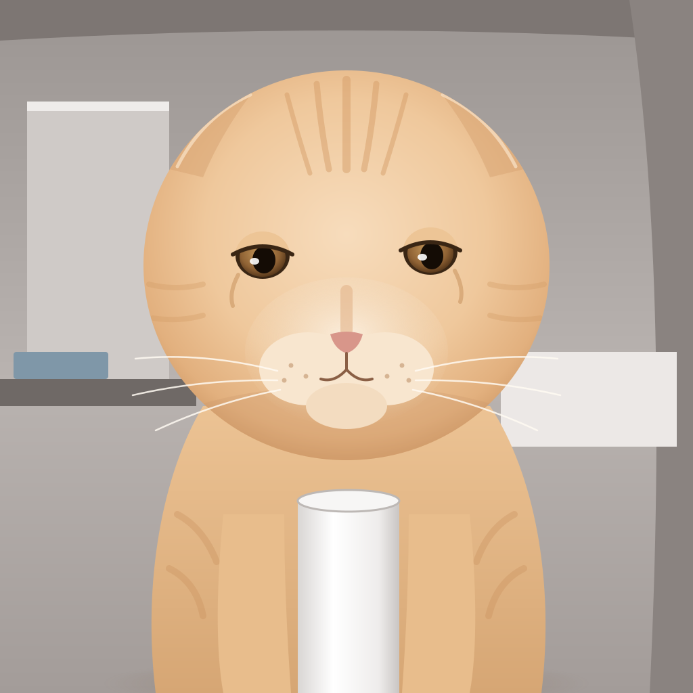

# 圆头耄耋 (original-photo remake)

Hand-built vector remake of the well-known screenshot from the original 圆头耄耋 video (orange cat sitting on a cat tree, staring at the camera).

## Features kept from the photo

- Ears pressed flat back (飞机耳), so from the front the head outline is an almost perfect circle; this is where the name "圆头" comes from
- Wide-set, half-lidded, dazed stare
- Pale cream-orange fur with faint forehead and cheek stripes; puffy white muzzle
- White cat-tree post in front of the chest, grey room in the background
- The "死掉了" sticker overlaid on the source image is left out
